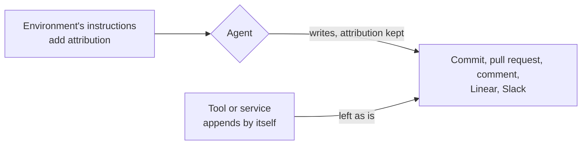

# Attribution

**Decision**: coding agents may add attribution to what they write: the header naming who asked, the "Generated with Claude Code" footer, the session link, the `Co-Authored-By: Claude` and `Claude-Session:` trailers. Once this change and its companions merge, nothing in [CONTRIBUTING.md](../../CONTRIBUTING.md) ("Coding agents") or any repository's `CLAUDE.md` forbids them. This reverses the no-attribution rule of [ENG-172](https://linear.app/arikkfir/issue/ENG-172) ([docs#65](https://github.com/arikkfir-org/docs/pull/65)). Ticket: [ENG-183](https://linear.app/arikkfir/issue/ENG-183). Pull request: [docs#69](https://github.com/arikkfir-org/docs/pull/69).

## Context

- From 2026-10-16 the house rules and every repository's `CLAUDE.md` forbade attribution, and told agents to edit out what a tool appends.
- Most of these lines come from the agents' environment, and much of it doesn't yield to `CLAUDE.md`: Claude projects' session instructions call the `Requested by` header required, the GitHub connector appends its footer to every pull request it opens and every review reply, and the session's GitHub gateway appends it again on every edit of a review comment.
- So the rule could not hold, agents spent turns editing lines out, and `arikkfir-reviewer` flagged lines the agent could not remove.

## Design

| Line                                                                    | Comes from                                                                  |
|-------------------------------------------------------------------------|-----------------------------------------------------------------------------|
| `Co-Authored-By: Claude …` and `Claude-Session: …` commit trailers      | Claude Code's attribution instructions                                      |
| `🤖 Generated with Claude Code` and session link ending a pull request  | The same instructions                                                       |
| `Generated by Claude Code` and session link ending a pull request       | The GitHub connector, which appends it to every pull request it opens       |
| `Requested by … · project thread` opening a pull request, hidden marker | Claude projects' session instructions                                       |
| `Generated by Claude Code` ending a GitHub comment                      | Session instructions, the GitHub connector and the session's GitHub gateway |

## Decisions

| Decision                                         | Why                                                                                                | Rejected                                                                                  |
|--------------------------------------------------|----------------------------------------------------------------------------------------------------|-------------------------------------------------------------------------------------------|
| Attribution is allowed wherever an agent writes  | Its sources don't yield to the house rules, so forbidding it cost turns and still let it through   | Keeping the rule: the reviewer flags lines nobody can remove                              |
| Allowed, not required                            | The environment adds the lines anyway; the house rules need not repeat its instructions            | Requiring it: a rule that only restates the environment's defaults                        |
| `Co-authored-by` for people and agents alike     | It credits whoever co-wrote the change                                                             | Keeping it for people only                                                                |

## Failure modes

| Failure                                                                            | Effect                                                                                                                                      |
|------------------------------------------------------------------------------------|---------------------------------------------------------------------------------------------------------------------------------------------|
| A repository's `CLAUDE.md` still carries the old rule                              | Its rules win there: agents keep omitting attribution and `arikkfir-reviewer` keeps flagging it until that repository's pull request merges |
| Attribution lands in a pull request description, and so in its merge commit's body | It stays in `git log` on `main` for good                                                                                                    |
| A session or project-thread link reaches a public repository                       | Anyone can see the link, but it opens only for the account that owns the session or project                                                 |

Security: most of the hub's repositories are public, so the lines are visible to anyone. They name the person who asked (display name and GitHub login) and link Claude pages that open only for their owner; none holds a secret or a credential.

## Rollout

Guidance only, from the next session that reads the rules. `docs#69` merges first; then each repository's `CLAUDE.md` drops the rule in its own pull request: [tooling#55](https://github.com/arikkfir-org/tooling/pull/55), [octomaton#53](https://github.com/arikkfir-org/octomaton/pull/53), [infra#87](https://github.com/arikkfir-org/infra/pull/87), [delivery#82](https://github.com/arikkfir-org/delivery/pull/82), [fin#178](https://github.com/arikkfir-org/fin/pull/178). `arikkfir-reviewer` reads the house rules and the repository's `CLAUDE.md` from `main` on every review, so it stops flagging attribution in a repository once both are merged.
