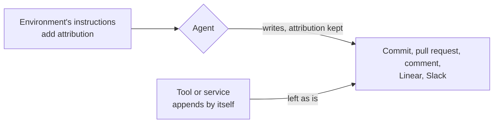

# Attribution

**Decision**: coding agents may add attribution to what they write: the header naming who asked, the "Generated with Claude Code" footer, the session link, the `Co-Authored-By: Claude` and `Claude-Session:` trailers. Nothing in [CONTRIBUTING.md](../../CONTRIBUTING.md) ("Coding agents") or any repository's `CLAUDE.md` forbids them. This reverses the no-attribution rule of [ENG-172](https://linear.app/arikkfir/issue/ENG-172) ([docs#65](https://github.com/arikkfir-org/docs/pull/65)). Ticket: [ENG-183](https://linear.app/arikkfir/issue/ENG-183).

## Context

- From 2026-10-16 the house rules and every repository's `CLAUDE.md` forbade attribution, and told agents to edit out what a tool appends.
- Most of these lines come from the agents' environment, and much of it doesn't yield to `CLAUDE.md`: Claude projects' session instructions call the `Requested by` header required, the GitHub connector appends its footer to every pull request it opens and every review reply, and the session's GitHub gateway appends it again on every edit of a review comment.
- So the rule could not hold, agents spent turns editing lines out, and `arikkfir-reviewer` flagged lines the agent could not remove.

## Design

| Line                                                                    | Comes from                                                                  |
|-------------------------------------------------------------------------|-----------------------------------------------------------------------------|
| `Co-Authored-By: Claude …` and `Claude-Session: …` commit trailers      | Claude Code's attribution instructions                                      |
| `🤖 Generated with Claude Code` and session link ending a pull request  | The same instructions                                                       |
| `Generated by Claude Code` and session link ending a pull request       | The GitHub connector, which appends it to every pull request it opens       |
| `Requested by … · project thread` opening a pull request, hidden marker | Claude projects' session instructions                                       |
| `Generated by Claude Code` ending a GitHub comment                      | Session instructions, the GitHub connector and the session's GitHub gateway |

## Decisions

| Decision                                         | Why                                                                                                | Rejected                                                                                  |
|--------------------------------------------------|----------------------------------------------------------------------------------------------------|-------------------------------------------------------------------------------------------|
| Attribution is allowed wherever an agent writes  | Its sources don't yield to the house rules, so forbidding it cost turns and still let it through   | Keeping the rule: the reviewer flags lines nobody can remove                              |
| Allowed, not required                            | The environment adds the lines anyway; the house rules need not repeat its instructions            | Requiring it: a rule that only restates the environment's defaults                        |
| `Co-authored-by` for people and agents alike     | It credits whoever co-wrote the change                                                             | Keeping it for people only                                                                |

## Rollout

None: guidance only, from the next session that reads the rules. `arikkfir-reviewer` reads the house rules and the repository's `CLAUDE.md` on every review, so it stops flagging attribution once both are merged.
