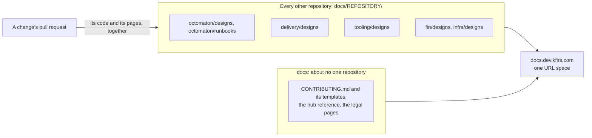
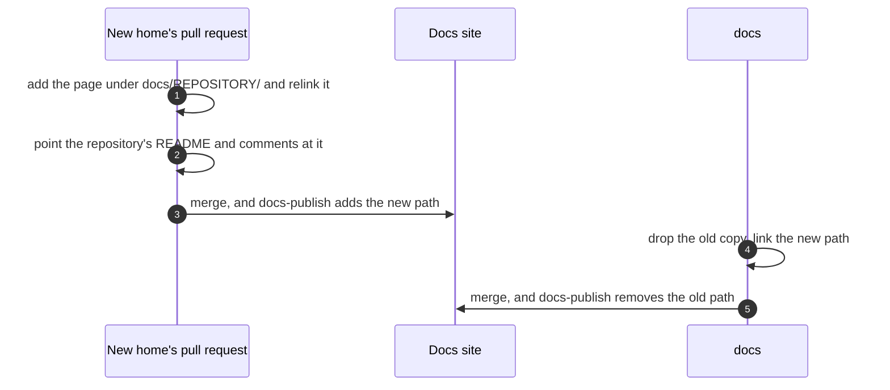

# Each repository owns its docs

**Decision**: a page about one repository lives in that repository, under its own `docs/<repository>/`, and changes in the pull requests of the code it describes. A page about several repositories is split into one part per repository, under the same name in each; only one that loses its value in parts stays whole, in the leading repository: the one whose change the others serve. `docs` keeps what is about no one repository and, over time, little else. Pages move a round at a time, the clear cases first; the rest wait for review ([Still in docs](#still-in-docs)). Tracked in ENG-121.

## Why

- A change and its design were two pull requests in two repositories: the code's, and a push to `docs`'s `main`. They were reviewed apart and merged at different times, and the code's pull request couldn't touch the page it changed. tooling's `CLAUDE.md` asks a change to the reviewer's findings schema to change "the design (`hub/designs/pr-reviewer.md` in `arikkfir-org/docs`)" with it, which that change's pull request can't do.
- The docs site already composes every repository's `docs/` into one URL space ([docs site composition](docs-site-composition.md)), and new designs already go there: `docs/delivery/designs/node-pools.md`, `docs/fin/designs/architecture.md`, `docs/octomaton/designs/archived-step-logs.md`. The pages left in `docs` predate that.

## Design

| A page about | Lives in | On the site |
| --- | --- | --- |
| One repository | That repository's `docs/<repository>/` | `/<repository>/…` |
| Several repositories | A part in each one's `docs/<repository>/`, under the same name, linking the others | `/<repository>/…` of each |
| Several, and worth less in parts | The leading repository's `docs/<repository>/` | `/<repository>/…` |
| No one repository: the house rules, their templates, the hub reference, the legal pages | `docs` | `/…` and `/hub/…` |

### Moving a page

- A page keeps its title and its text, and its name without its repository's prefix: `octomaton-architecture.md` is now `octomaton/designs/architecture.md`. Only its links change: to pages that moved with it, by their new paths; to pages still in `docs`, through `../../hub/`.
- The new home's pull request also points that repository's own README and comments at the page, and merges first. `docs` drops the old copy and points its own pages at the new path once every new home of its round has merged, so its links resolve.
- The `Docs` check reads only the links of the repository under test. A repository that still links an old path fails its next check once `docs` drops it, so a round updates every repository's links to the pages it moves.
- Two pages that move to two repositories in one round and link each other can't both link the other's new path: neither is published before the other merges. One of them moves in a later round, once the other is published. That is why `go-import-pages.md` waits for `octomaton-dev.md`.
- A move is the one pull request of documentation alone (`CONTRIBUTING.md`, "Pull requests"): it documents no change of its own.

### Moved

| Was | Now | Pull request |
| --- | --- | --- |
| `hub/designs/phase-2-octomaton.md` | [octomaton/designs/phase-2-octomaton.md](../../octomaton/designs/phase-2-octomaton.md) | arikkfir-org/octomaton#30 |
| `hub/designs/octomaton-architecture.md` | [octomaton/designs/architecture.md](../../octomaton/designs/architecture.md) | arikkfir-org/octomaton#30 |
| `hub/designs/octomaton-deployment.md` | [octomaton/designs/deployment.md](../../octomaton/designs/deployment.md) | arikkfir-org/octomaton#30 |
| `hub/designs/octomaton-github-retries.md` | [octomaton/designs/github-retries.md](../../octomaton/designs/github-retries.md) | arikkfir-org/octomaton#30 |
| `hub/designs/octomaton-dev.md` | [octomaton/designs/octomaton-dev.md](../../octomaton/designs/octomaton-dev.md) | arikkfir-org/octomaton#30 |
| `hub/designs/check-run-redaction.md` | [octomaton/designs/check-run-redaction.md](../../octomaton/designs/check-run-redaction.md) | arikkfir-org/octomaton#30 |
| `hub/runbooks/octomaton-rename.md` | [octomaton/runbooks/rename.md](../../octomaton/runbooks/rename.md) | arikkfir-org/octomaton#30 |
| `hub/designs/phase-3-ingress-and-auth.md` | [delivery/designs/phase-3-ingress-and-auth.md](../../delivery/designs/phase-3-ingress-and-auth.md) | arikkfir-org/delivery#58 |
| `hub/designs/phase-5-tooling.md` | [tooling/designs/phase-5-tooling.md](../../tooling/designs/phase-5-tooling.md) | arikkfir-org/tooling#36 |

### Staying in docs

| Page | Why |
| --- | --- |
| `CONTRIBUTING.md`, `README.md`, `hub/templates/` | The house rules and their templates, for every repository |
| [Service conventions](service-conventions.md), [pull request titles](pull-request-titles.md), [writing issues](writing-issues.md), [investigations and walkthroughs](investigations-and-walkthroughs.md) | The designs of `CONTRIBUTING.md`'s rules, which live here |
| [Phase 0](phase-0-documentation.md), [phase 4](phase-4-docs-site.md) | This repository's own designs: the knowledge base, and how it first published |
| [Hub overview](../overview.html) | The whole hub on one page |
| `privacy.md`, `tos.md` | `legal.kfirs.com` serves them from this layer, which the site overlays first, so no other repository can replace them |

### Still in docs

Each is about several repositories, or its home needs a decision. Proposed homes, for review; none moves in this change. Moving a page that a house rule or a repository's `CLAUDE.md` cites is a change of its own, which rewrites that rule first:

| Page | Proposed | Open point |
| --- | --- | --- |
| [Go import pages](go-import-pages.md) | delivery, whole: `platform/go-import` | None. It and `octomaton-dev.md` link each other, so it moves once that one is published |
| [Claude Code cluster access](claude-code-cluster-access.md) | tooling, whole: the `gke` MCP server and its permissions | infra holds the identity and its roles, nearly half the design |
| [CI reports](ci-reports.md) | fin, whole: its end-to-end task writes the reports | delivery's `/reports/` route serves any repository's reports, and could join the docs site's design instead |
| [Pull request reviewer](pr-reviewer.md) | tooling (`reviewer/`), with its Octomaton section split into octomaton | Octomaton's part: review requests, `secrets`, `githubToken.repositories`, remote references refused, organization pipelines |
| [Terraform plan and apply](terraform-plan-apply.md) | infra (`ci` and `apply`), with "ServiceAccount branches" split into octomaton | |
| [Keycloak](keycloak.md) | Split: infra (`terraform/keycloak`, its secrets, the pipelines' clients), delivery (the operator, PostgreSQL, the routes, oauth2-proxy's sign-out) | Its rollout runs across both as one sequence |
| [Phase 1](phase-1-foundations.md) | Split: infra (the roots, GCP's topology, the rulesets), delivery (Argo CD and the components) | |
| [Fin on the hub](fin-platform.md) | Split: delivery (the admitted kinds and their policies, production's ServiceAccounts, NATS's policy), infra (pool `fin-pull-requests`, the grants, the buckets), fin (`components/pull-request`) | Three ways |
| [Docs site composition](docs-site-composition.md) | Split: tooling (`docs-site/`: the check and publishing), delivery (`platform/docs`: serving), infra (the two ServiceAccounts' roles); or whole in tooling | This repository's `CLAUDE.md` and `CONTRIBUTING.md` lean on it |
| [CI ServiceAccounts](ci-service-accounts.md) | Split: delivery (the ServiceAccounts and their annotation), infra (their roles) | `CONTRIBUTING.md`'s least-privilege rule cites it, so it could stay as that rule's design |
| [Disruption budgets](disruption-budgets.md) | delivery, merged into its own `disruption-budgets.md`, which already supersedes part of it | Same name as delivery's page: merge, or rename |
| [Resource requests](resource-requests.md) | Split: delivery (eleven workloads), fin (five), and its rule into `CONTRIBUTING.md` | delivery's and fin's manifests cite it as the hub's rule |
| [Bootstrap runbook](../runbooks/bootstrap.md) | infra, whole: infra's README links it, and most of its steps apply infra's roots | One sequence across every repository |
| [Hub reference](../reference.md) | Undecided: whole here, or split by section into each repository (Octomaton's server configuration and `.octomaton.yaml` schema into octomaton, Fin's section into fin), keeping the hub-wide facts here | It is the contract: a name changes here first (`CONTRIBUTING.md`, "Facts in one place"), and every repository's `CLAUDE.md` names it. A split rewrites those rules first, and still changes each fact in one place |

## Decisions

| Decision | Why | Rejected |
| --- | --- | --- |
| Each repository's pages under `<repository>/` on the site | No repository's paths collide with another's, and delivery, fin, infra and octomaton already keep their pages there | Keeping each page's path (`hub/designs/…`) in its new repository: no link would change, but the `Docs` check refuses the new copy while `docs` still publishes the old one, so the page would be off the site between the two merges, and `hub/` would mix every repository's pages |
| Split a page about several repositories before keeping it whole | Each repository's part then changes with that repository's code, in its pull requests | The leading repository first, the rule until now |
| No pages left behind at the old paths | `docs` is meant to empty out, and every such page would wait for a cleanup of its own | A page per old path pointing at the new one, which would keep links from outside the repositories working |
| The clear cases first, the rest after review | A page in the wrong home costs a round of pull requests in several repositories to move again | Every page at once |
| Names without the repository's prefix | Inside `octomaton/`, `octomaton-` says nothing; `fin/designs/architecture.md` already reads so | The names as they were |

## Failure modes

- Links to an old path from outside the repositories (merged pull requests' descriptions, Linear issues, bookmarks) answer 404, on the site and on GitHub. The tables above map every moved page's old path to its new one.
- Between a new home's merge and `docs`'s, the page is on the site twice, and only `docs`'s own pages link the old copy.
- `docs`'s change fails the `Docs` check until every new home of its round is published: it links their new paths.

## Rollout

1. arikkfir-org/octomaton#30, arikkfir-org/tooling#36 and arikkfir-org/delivery#58: the pages in their new homes, in any order.
2. `docs`: this design, the house rules (`CONTRIBUTING.md`, `CLAUDE.md`, `README.md`, the docs site's design), and the old copies dropped and relinked, once all three are published.
3. The pages under [Still in docs](#still-in-docs), a round at a time, as their homes are decided.

## Open questions

- Root-cause write-ups and walkthroughs: their templates put a public repository's in `docs`. By this design, a write-up would live in the repository it is about and a walkthrough in the pull request it explains, but a write-up that ships no fix would be a pull request of documentation alone.
- Whether each repository's `CLAUDE.md` should say where its pages live, as delivery's and fin's already name theirs; `CONTRIBUTING.md` says it once for every repository.
