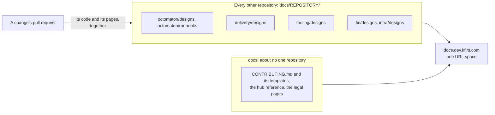
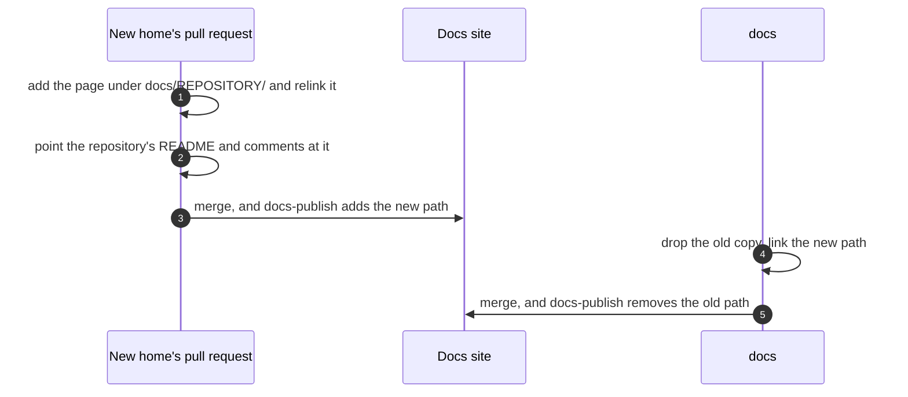

# Each repository owns its docs

**Decision**: a page about one repository lives in that repository, under its own `docs/<repository>/`, and changes in the pull requests of the code it describes. A page about several repositories is split into one part per repository, under the same name in each; only one that loses its value in parts stays whole, in the leading repository: the one whose change the others serve. `docs` keeps what is about no one repository and, over time, little else. Pages move a round at a time, the clear cases first; the rest wait for review ([Still in docs](#still-in-docs)). Tracked in ENG-121.

## Why

- A change and its design were two pull requests in two repositories: the code's, and a push to `docs`'s `main`. They were reviewed apart and merged at different times, and the code's pull request couldn't touch the page it changed. tooling's `CLAUDE.md` asks a change to the reviewer's findings schema to change "the design (`hub/designs/pr-reviewer.md` in `arikkfir-org/docs`)" with it, which that change's pull request can't do.
- The docs site already composes every repository's `docs/` into one URL space ([docs site composition](docs-site-composition.md)), and new designs already go there: `docs/delivery/designs/node-pools.md`, `docs/fin/designs/architecture.md`, `docs/octomaton/designs/archived-step-logs.md`. The pages left in `docs` predate that.

## Design

| A page about | Lives in | On the site |
| --- | --- | --- |
| One repository | That repository's `docs/<repository>/` | `/<repository>/…` |
| Several repositories | A part in each one's `docs/<repository>/`, under the same name, linking the others | `/<repository>/…` of each |
| Several, and worth less in parts | The leading repository's `docs/<repository>/` | `/<repository>/…` |
| No one repository: the house rules, their templates, the hub reference, the legal pages | `docs` | `/…` and `/hub/…` |

### Moving a page

- A page keeps its title and its text, and its name without its repository's prefix: `octomaton-architecture.md` is now `octomaton/designs/architecture.md`. Only its links change: to pages that moved with it, by their new paths; to pages still in `docs`, through `../../hub/`.
- The new home's pull request also points that repository's own README and comments at the page, and merges first. `docs` drops the old copy and points its own pages at the new path once every new home of its round has merged, so its links resolve.
- The `Docs` check reads only the links of the repository under test. A repository that still links an old path fails its next check once `docs` drops it, so a round updates every repository's links to the pages it moves.
- Two pages that move to two repositories in one round and link each other can't both link the other's new path: neither is published before the other merges. One of them moves in a later round, once the other is published. That is why `go-import-pages.md` moved a round after `octomaton-dev.md`.
- A move is the one pull request of documentation alone (`CONTRIBUTING.md`, "Pull requests"): it documents no change of its own.

### Moved

| Was | Now | Pull request |
| --- | --- | --- |
| `hub/designs/phase-2-octomaton.md` | [octomaton/designs/phase-2-octomaton.md](../../octomaton/designs/phase-2-octomaton.md) | arikkfir-org/octomaton#30 |
| `hub/designs/octomaton-architecture.md` | [octomaton/designs/architecture.md](../../octomaton/designs/architecture.md) | arikkfir-org/octomaton#30 |
| `hub/designs/octomaton-deployment.md` | [octomaton/designs/deployment.md](../../octomaton/designs/deployment.md) | arikkfir-org/octomaton#30 |
| `hub/designs/octomaton-github-retries.md` | [octomaton/designs/github-retries.md](../../octomaton/designs/github-retries.md) | arikkfir-org/octomaton#30 |
| `hub/designs/octomaton-dev.md` | [octomaton/designs/octomaton-dev.md](../../octomaton/designs/octomaton-dev.md) | arikkfir-org/octomaton#30 |
| `hub/designs/check-run-redaction.md` | [octomaton/designs/check-run-redaction.md](../../octomaton/designs/check-run-redaction.md) | arikkfir-org/octomaton#30 |
| `hub/runbooks/octomaton-rename.md` | [octomaton/runbooks/rename.md](../../octomaton/runbooks/rename.md) | arikkfir-org/octomaton#30 |
| `hub/designs/phase-3-ingress-and-auth.md` | [delivery/designs/phase-3-ingress-and-auth.md](../../delivery/designs/phase-3-ingress-and-auth.md) | arikkfir-org/delivery#58 |
| `hub/designs/phase-5-tooling.md` | [tooling/designs/phase-5-tooling.md](../../tooling/designs/phase-5-tooling.md) | arikkfir-org/tooling#36 |
| `hub/designs/ci-reports.md` | Split, as the reports moved to their own server (ENG-122): [fin/designs/ci-reports.md](../../fin/designs/ci-reports.md), how Fin's are made and opened, and [delivery/designs/docs-and-tests-servers.md](../../delivery/designs/docs-and-tests-servers.md), how both servers serve | arikkfir-org/fin#139, arikkfir-org/delivery#59 |
| `hub/designs/terraform-plan-apply.md` | [infra/designs/terraform-plan-apply.md](../../infra/designs/terraform-plan-apply.md), the CI only; Octomaton's ServiceAccount branch check into [octomaton/designs/phase-2-octomaton.md](../../octomaton/designs/phase-2-octomaton.md#serviceaccount-branches) | arikkfir-org/infra#69, arikkfir-org/octomaton#31 |
| `hub/designs/phase-1-foundations.md` | Merged into a page per Terraform root: [gcp](../../infra/terraform/gcp.md), [argocd](../../infra/terraform/argocd.md), [github](../../infra/terraform/github.md) | arikkfir-org/infra#69 |
| `hub/runbooks/bootstrap.md` | [infra/runbooks/bootstrap.md](../../infra/runbooks/bootstrap.md), whole | arikkfir-org/infra#69 |
| `hub/designs/keycloak.md` | Split: [infra/terraform/keycloak.md](../../infra/terraform/keycloak.md), its configuration, and [delivery/designs/keycloak.md](../../delivery/designs/keycloak.md), its deployment | arikkfir-org/infra#69, arikkfir-org/delivery#60 |
| `hub/designs/fin-platform.md` | Rewritten as [fin/designs/hub.md](../../fin/designs/hub.md), Fin's architecture on the hub | arikkfir-org/fin#141 |
| `hub/designs/ci-service-accounts.md` | Merged into [octomaton/designs/phase-2-octomaton.md](../../octomaton/designs/phase-2-octomaton.md#tenancy-and-identity), "Tenancy and identity" | arikkfir-org/octomaton#31 |
| `hub/designs/disruption-budgets.md` | Merged into [delivery/designs/disruption-budgets.md](../../delivery/designs/disruption-budgets.md) | arikkfir-org/delivery#60 |
| `hub/designs/resource-requests.md` | Split: [delivery/designs/resource-requests.md](../../delivery/designs/resource-requests.md), the hub's components, and [fin/designs/resource-requests.md](../../fin/designs/resource-requests.md), Fin's; the rule into `CONTRIBUTING.md`, "Code and configuration" | arikkfir-org/delivery#60, arikkfir-org/fin#141 |
| `hub/designs/pr-reviewer.md` | Split: [tooling/designs/pr-reviewer.md](../../tooling/designs/pr-reviewer.md), the reviewer and how authors work with it, and [octomaton/designs/pr-reviewer.md](../../octomaton/designs/pr-reviewer.md), Octomaton's part | arikkfir-org/tooling#41, arikkfir-org/octomaton#31 |
| `hub/designs/go-import-pages.md` | [delivery/designs/go-import-pages.md](../../delivery/designs/go-import-pages.md), whole | arikkfir-org/delivery#61 |
| `hub/designs/claude-code-cluster-access.md` | [tooling/designs/claude-code-cluster-access.md](../../tooling/designs/claude-code-cluster-access.md), whole; infra's [root gcp](../../infra/terraform/gcp.md) describes the identity and its roles | arikkfir-org/tooling#45 |

### Staying in docs

| Page | Why |
| --- | --- |
| `CONTRIBUTING.md`, `README.md`, `hub/templates/` | The house rules and their templates, for every repository |
| [Service conventions](service-conventions.md), [pull request titles](pull-request-titles.md), [writing issues](writing-issues.md), [investigations and walkthroughs](investigations-and-walkthroughs.md) | The designs of `CONTRIBUTING.md`'s rules, which live here |
| [Phase 0](phase-0-documentation.md), [phase 4](phase-4-docs-site.md), [docs site composition](docs-site-composition.md) | This repository's own designs: the knowledge base, how it first published, and the site it is served on |
| [Hub reference](../reference.md) | The contract every repository's `CLAUDE.md` names. Whether to split it by owner is the next round's question |
| [Hub overview](../overview.html) | The whole hub on one page |
| `privacy.md`, `tos.md` | `legal.kfirs.com` serves them from this layer, which the site overlays first, so no other repository can replace them |

### Still in docs

None: the last two pages moved in the third round ([Moved](#moved)). Only the hub reference's split is still open ([Staying in docs](#staying-in-docs)).

## Decisions

| Decision | Why | Rejected |
| --- | --- | --- |
| Each repository's pages under `<repository>/` on the site | No repository's paths collide with another's, and delivery, fin, infra and octomaton already keep their pages there | Keeping each page's path (`hub/designs/…`) in its new repository: no link would change, but the `Docs` check refuses the new copy while `docs` still publishes the old one, so the page would be off the site between the two merges, and `hub/` would mix every repository's pages |
| Split a page about several repositories before keeping it whole | Each repository's part then changes with that repository's code, in its pull requests | The leading repository first, the rule until now |
| No pages left behind at the old paths | `docs` is meant to empty out, and every such page would wait for a cleanup of its own | A page per old path pointing at the new one, which would keep links from outside the repositories working |
| The clear cases first, the rest after review | A page in the wrong home costs a round of pull requests in several repositories to move again | Every page at once |
| Names without the repository's prefix | Inside `octomaton/`, `octomaton-` says nothing; `fin/designs/architecture.md` already reads so | The names as they were |
| What `infra` provisions is described once, a page per Terraform root; other repositories list what they use and link those pages | One place to change when the infrastructure changes, in the pull request that changes it | Each repository describing the infrastructure it relies on |
| A page is linked by its place on the docs site, never as "file X in repository Y"; outside the site, by its URL | Claude Code's sessions read the site from its bucket, so a link is all they need, where a path in another repository meant cloning it | Paths in named repositories |
| The reviewer's design in `tooling`, beside its code (`reviewer/`), with only Octomaton's part in `octomaton` | A change to the reviewer's findings schema changes its design in the same pull request, which `tooling`'s `CLAUDE.md` asks for | The reviewer's mechanics in `octomaton` |
| Claude Code's cluster and docs access in `tooling`, whole | `tooling`'s bundle declares the `gke` MCP server and the permissions of its tools, and its sessions are what reads the docs; infra's root `gcp` page already describes `claude-code@` and its roles, and links it | A split with infra's half in `infra`: that half is already its root page |
| `docs` takes pull requests too | Its pages get the same review and the same `Docs` check before they merge, instead of after a push to `main` | Pushing to `main` directly, as until this round |

## Failure modes

- Links to an old path from outside the repositories (merged pull requests' descriptions, Linear issues, bookmarks) answer 404, on the site and on GitHub. The tables above map every moved page's old path to its new one.
- Between a new home's merge and `docs`'s, the page is on the site twice, and only `docs`'s own pages link the old copy.
- `docs`'s change fails the `Docs` check until every new home of its round is published: it links their new paths.

## Rollout

1. arikkfir-org/octomaton#30, arikkfir-org/tooling#36 and arikkfir-org/delivery#58: the pages in their new homes, in any order.
2. `docs`: this design, the house rules (`CONTRIBUTING.md`, `CLAUDE.md`, `README.md`, the docs site's design), and the old copies dropped and relinked, once all three are published.
3. The second round: infra (arikkfir-org/infra#69) and tooling (arikkfir-org/tooling#41); then fin (arikkfir-org/fin#141) and octomaton (arikkfir-org/octomaton#31); then delivery (arikkfir-org/delivery#60); then `docs`, which drops the old copies, takes pull requests from now on, and puts the resource requests rule in `CONTRIBUTING.md`. Every repository's `CLAUDE.md` says where its pages are and how a session reads the site.
4. The third round: delivery (arikkfir-org/delivery#61) and tooling (arikkfir-org/tooling#45); then octomaton (arikkfir-org/octomaton#32) and infra (arikkfir-org/infra#72) relink them; then `docs` drops the last two pages.
5. Whether to split the hub reference by owner.

## Open questions

- Root-cause write-ups and walkthroughs: their templates put a public repository's in `docs`. By this design, a write-up would live in the repository it is about and a walkthrough in the pull request it explains, but a write-up that ships no fix would be a pull request of documentation alone.
