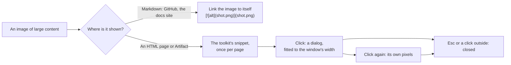

# Images open at full size

**Decision**: every screenshot, and any other image of large content such as a wide capture, opens at full size when clicked, wherever it is shown: a design, a write-up, a walkthrough, an Artifact, a pull request. Markdown links the image to itself; an HTML page or Artifact pastes the [writing toolkit](../templates/toolkit.md#images)'s click-to-enlarge snippet. The rule is in [CONTRIBUTING.md](../../CONTRIBUTING.md) ("Design documents", "Images at full size"). Ticket: [ENG-316](https://linear.app/arikkfir/issue/ENG-316).

## Context

- Reviews of visual changes run on screenshots: a Console page beside its Figma screen, light and dark, at 1440 wide. Sessions publish them as Artifacts, two to a row, each shrunk to half a column.
- The owner, reading such an Artifact, found the screenshots really hard to read at that size, and nothing on the page showed them bigger.
- The house rules said how a page uses diagrams, tables and drill-downs, and nothing about images.
- An Artifact's images are usually `data:` URIs. A link to one does not help: browsers refuse to open a `data:` URL in a tab of its own.

## Design

The snippet marks only images shown smaller than their own size, so icons and images already at full size stay as they are, and leaves an image inside a link to its link. It opens a copy of the image in a modal `<dialog>`, which needs no new tab and so works for `data:` images, and closes the way any dialog does.

## Decisions

| Decision                                                      | Why                                                                                                      | Rejected                                                                                         |
|---------------------------------------------------------------|----------------------------------------------------------------------------------------------------------|--------------------------------------------------------------------------------------------------|
| Every screenshot, on every page and Artifact                  | Screenshots appear in designs, write-ups, walkthroughs and review Artifacts alike                        | A rule for walkthroughs only: the image that prompted it was in a review Artifact                |
| Click to enlarge, not larger images on the page               | Side by side is how two screens are compared; full width for each would end the comparison               | One image per row at full width                                                                  |
| A `<dialog>` in the page, not a link to the image             | An Artifact's `data:` images can't open in a tab of their own, and a dialog keeps the reader on the page | `<a href="data:…" target="_blank">`: browsers block it                                           |
| Fitted to the window first, its own pixels on a second click  | A 2× screenshot at its own pixels is twice the screen's width; fitted, it already reads                  | Only its own pixels, which scroll both ways; only fitted, which loses the detail of a 2× capture |
| Images shown smaller than their size only                     | Icons and images already at full size have nothing to show                                               | Every image, which puts a zoom cursor on icons                                                   |
| Markdown links the image to itself                            | It works on GitHub and on the docs site with nothing to load, and GitHub strips scripts                  | The snippet in Markdown: GitHub strips it                                                        |

## Rollout

- The rule ships in this repository's house rules and reaches Claude Code sessions through `tooling`'s copy of them in its bundle.
- Pages and Artifacts published before the rule change only when next edited.

## Open questions

- None.
