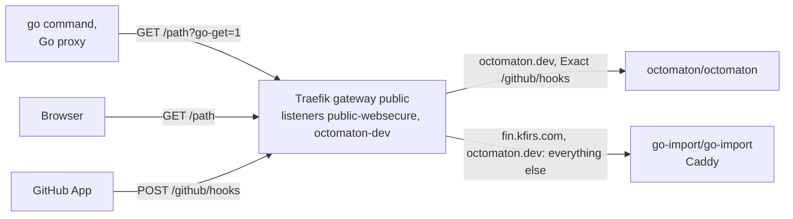

# Go import pages

**Decision**: one Caddy, `delivery`'s `go-import`, answers Go's import requests for every hub domain that is a Go
module path: `fin.kfirs.com` and `octomaton.dev`. A table in its configuration names each domain's repository and,
optionally, where people who open the domain in a browser go; without one they go to `https://github.com/arikkfir-org`.
Octomaton's own `go-import` goes. Names and wiring: [reference](../reference.md#go-import-pages).

## Context

The `go` command resolves a module path such as `octomaton.dev/cmd/octomaton` by fetching
`https://octomaton.dev/cmd/octomaton?go-get=1` and reading its `go-import` tag, which names the repository
([octomaton.dev](octomaton-dev.md#go-module-resolution)). Octomaton's `deploy/` ran a Caddy for `octomaton.dev`, and
`delivery` added a second for `fin.kfirs.com`: Fin's `deploy/` can't serve its own, since it also deploys from pull
requests and its namespaces are held off the public gateway. Two workloads, four pods, gave the same static answer for
two domains.

## Design

| Request | Answer |
| --- | --- |
| A listed domain, `go-get=1`, any path | `200` with `<meta name="go-import" content="<domain> git <repository>">` |
| A listed domain, anything else | `302` to the domain's redirect URL, or `https://github.com/arikkfir-org` |
| Any other host | `302` to `https://github.com/arikkfir-org` (no route sends one) |

Caddy's `map` turns the request's host into the domain's repository and redirect URL, one row per domain; `-` in the
redirect column, and the `default` row, give the organization's page. HTTPRoute `go-import` lists the same domains and
attaches to each one's listener: `public-websecure` for names under `*.kfirs.com`, `octomaton-dev` for `octomaton.dev`.
Octomaton's route keeps only `/github/hooks`, and an exact path takes precedence over `go-import`'s prefix.

## Decisions

| Decision | Why | Rejected |
| --- | --- | --- |
| One `go-import` in `delivery` | The answer is static, the same for every domain but its row; one workload to pin, spread and budget | One per product (the domain's owner serves it, as Octomaton did): two copies of the same Caddy, and Fin can't serve one |
| A table in one Caddyfile (`map`) | A new domain is one row; the handlers stay the same | A handler block per domain; a small Go server |
| Redirect per domain, organization's page by default | Each product points people where it wants; a domain without a page of its own still lands somewhere useful | `404` for every request without `go-get=1` |
| Listener `octomaton-dev` admits namespace `go-import` too | The route lives with the workload it points at | A route in `octomaton` pointing across namespaces: it needs a ReferenceGrant, and splits the page's wiring across two repositories |

## Security and failure modes

- The pages are public and static. They name only repositories; reading a private one (`fin`) still takes access to
  it.
- A second namespace can now attach routes to `octomaton.dev`. Both namespaces' contents come from `main` of their
  repositories, and Octomaton's webhook path is an exact match, which `go-import`'s prefix never outranks.
- If `go-import` is down, new `go install`s and builds that resolve these modules directly fail; versions already in
  the Go proxy keep working.

## Rollout

1. This reference, on `docs`'s `main`.
2. `delivery`: the table, `octomaton.dev` on route `go-import`, and listener `octomaton-dev` admitting namespace
   `go-import`. Until step 3, both routes take `octomaton.dev`'s other paths, and both answer the same.
3. `octomaton`: `deploy/` drops its `go-import` and the route's catch-all rule, once step 2 is synced.
4. Check: `curl -s 'https://octomaton.dev/cmd/octomaton?go-get=1'` and `curl -s 'https://fin.kfirs.com/apps/api?go-get=1'`
   return their tags, and `kubectl get deploy -A` lists one `go-import`.
