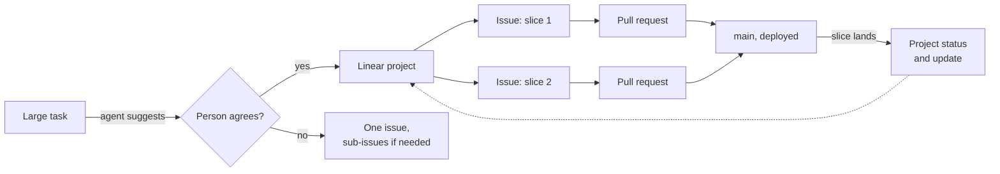

# Linear projects

**Decision**: a task too large for one issue gets a Linear project. Agents suggest it to their person and create it only once they agree. Each slice of the work gets its own issue in the project, slices are preferably self-contained and deployable on their own, and the project's status and updates stay current as slices land. The rules are in [CONTRIBUTING.md](../../CONTRIBUTING.md) ("Projects"). Ticket: [ENG-166](https://linear.app/arikkfir/issue/ENG-166). Pull request: [docs#63](https://github.com/arikkfir-org/docs/pull/63).

## Context

- `CONTRIBUTING.md` covered issues only: one pull request per issue, and sub-issues for a large one. It said nothing about projects.
- ENG already runs projects (Fin's ledger as a tree, Replace Descope with Keycloak, Institutions and others), but each session decided for itself whether to create one, how to cut its issues and whether to report progress on it.

## Design

## Decisions

| Decision                                                                                  | Why                                                                                                                         | Rejected                                                                                     |
|-------------------------------------------------------------------------------------------|-----------------------------------------------------------------------------------------------------------------------------|----------------------------------------------------------------------------------------------|
| A task too large for one issue gets a project                                             | A project holds the goal, its slices and their progress in one place, across repositories and over many sessions            | One large issue with sub-issues: no status or updates of its own, and it reads as one change |
| Agents suggest a project; they create it only once their person agrees                    | A project sets the plan its person will follow for weeks; they decide whether the task is that large and how to cut it      | Agents creating projects unasked: projects nobody planned would fill the workspace           |
| One issue per slice                                                                       | Each pull request links its issue (check `Linear`), so a slice's issue closes when it merges and the project shows progress | Issues per repository or per layer: they finish without anything working                     |
| Slices are preferably self-contained and deployable on their own                          | Every merge to `main` releases, so a slice that leaves `main` working can ship, be reviewed and be rolled back on its own   | Slices that only work together: half-done work sits on `main` or in long-lived branches      |
| The project's status stays current; an update posts at milestones and significant changes | The person reads progress without opening each issue; a health of on track, at risk or off track says when to step in       | An update per pull request: noise that buries the milestones                                 |

## Failure modes

Nothing checks these rules: Linear accepts any project and any slice. They hold only as long as whoever plans the work follows `CONTRIBUTING.md`. A slice that can't stand on its own is allowed ("preferably"), and its pull request says why.

## Rollout

None: guidance only. Existing projects keep their shape; the rules apply from the next large task.
