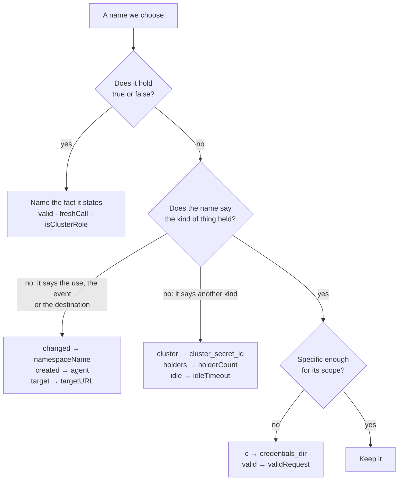

# Names say what they hold

**Decision**: a name says what the thing holds, its kind or content, never what it will be used for, what happened to it or where it is going. A boolean is named for the fact it states; a count, an ID, an error, a duration, a path, a URL and a prefix each say so; acronyms keep their capitals inside a mixed-case name; generated code is renamed at its origin. The rule is in [CONTRIBUTING.md](../../CONTRIBUTING.md) ("Code and configuration", "Name what it holds"). Tickets: [ENG-310](https://linear.app/arikkfir/issue/ENG-310) for the rule, [ENG-308](https://linear.app/arikkfir/issue/ENG-308) for the scan. Pull request: [docs#81](https://github.com/arikkfir-org/docs/pull/81).

## Context

- The owner found a CEL variable named `changed` in one of `delivery`'s admission policies that holds a namespace's name. The name says what happened to the value and hides what it is, so a reader has to evaluate the expression to follow the validation that uses it.
- It was not one name. A scan of `infra`, `delivery` and `cobranch` on 2026-11-28 found 426 names of the same kind, 307 of them worth renaming, in about 3,400 places:

  | Area                           | Candidates | Worth renaming |
  |--------------------------------|-----------:|---------------:|
  | `cobranch`: Go services        |        156 |            119 |
  | `cobranch`: Console, chart, CI |         72 |             53 |
  | `cobranch`: Go adapters        |         63 |             41 |
  | `cobranch`: API and transports |         50 |             34 |
  | `cobranch`: database           |         49 |             39 |
  | `delivery`                     |         26 |             15 |
  | `infra`                        |         10 |              6 |

- Most come from one habit: naming a value with a past participle, as if the code were a sentence. In `cobranch`'s hand-written code, `held` is declared 104 times and holds permission lists, maps, counts, a struct and a boolean; `created` 52 times, for whatever a call returned; `shown` 49 times, for seven kinds of thing.
- Until now the house rules said only how a name is cased, so a reviewer had nothing to refuse such a name by.

## Design

The rule covers every name we choose: variables, parameters, fields, types, tables, columns, triggers, query aliases, Helm values, CEL variables, labels and object names. Names an outside contract fixes (a Kubernetes field, a chart's own value, a standard library's method) are not ours to choose.

| Holds                 | Named                                                         | Not                                   |
|-----------------------|---------------------------------------------------------------|---------------------------------------|
| A fact, true or false | `valid`, `freshCall`, `isClusterRole`                         | `role`, `pods` for a boolean          |
| A count               | `holderCount`, `source_count`                                 | `holders`, `sources`                  |
| An ID                 | `agentID`, `cluster_secret_id`                                | `agent`, `cluster`                    |
| An error              | `keyErr`                                                      | `key`, `expired`                      |
| A duration            | `idleTimeout`, `resyncInterval`, `preparedTTL`, `freshMillis` | `idle`, `resync`, `prepared`, `fresh` |
| A path, URL or prefix | `title-path`, `octomaton_repo_url`, `subjectPrefix`           | `title`, `octomaton`, `subjects`      |
| What a call returned  | `agent`, `threadIDs`                                          | `created`, `changed`                  |

Each language keeps its own casing: `sourceCount` in Go and JavaScript, `source_count` in SQL and shell, `source-count` in a Tekton param.

## Decisions

| Decision                                                                | Why                                                                                                                                            | Rejected                                                                                                                  |
|-------------------------------------------------------------------------|------------------------------------------------------------------------------------------------------------------------------------------------|---------------------------------------------------------------------------------------------------------------------------|
| Name the kind or content held, never the use or the event               | The kind is what a reader needs at every use, and it stays true when the value gains a second use                                              | Names for the role a value plays (`changed`, `target`, `held`): they read well once, at the declaration, and nowhere else |
| A boolean is named for the fact it states, and nothing else is          | `valid` and `freshCall` already say what they hold; a participle on anything else then signals a mistake                                       | An `is` prefix on every boolean: `valid` is clear without it                                                              |
| Counts, IDs, errors, durations, paths, URLs and prefixes say so         | These are the kinds the scan found most often hidden behind the name of the thing they belong to                                               | Hungarian notation for every type: a suffix is needed only where the bare noun would claim another kind                   |
| The wider the scope, the more specific the name                         | `valid` is enough in five lines; across a file the reader asks "what is valid?"                                                                | One length for every scope                                                                                                |
| Acronyms keep their capitals inside a mixed-case name, lower-case alone | It is Go's idiom, which most of our code is written in: `spendUSD`, `orgID`, and `usd` alone                                                   | `spendUsd`, `orgId`: two spellings of one word across Go and the rest                                                     |
| Generated code is renamed at its origin                                 | The next generation overwrites an edit to the output, so the origin (the SQL, the schema, the OpenAPI document) is the only place a name lives | Editing generated files                                                                                                   |
| Short idiomatic names stay                                              | `i`, `err`, `ctx`, `ok` and `tx` are a language's own vocabulary in a tight scope                                                              | Banning one-letter names                                                                                                  |
| The rule is a house rule, not a linter                                  | No linter can tell that `changed` holds a namespace's name; the reviewer reads the house rules and can                                         | A list of banned words: `changed` is right for a boolean, and wrong words are endless                                     |

## Failure modes

- A name that breaks the rule merges anyway unless `arikkfir-reviewer` or the human reviewer refuses it: nothing else checks it.
- A rename can break what refers to the name from outside its file. In a compiled language the build catches it; in YAML, shell, templates and JavaScript nothing does, so each such rename is checked by rendering or running what it touches. A CEL variable an expression names but the policy doesn't declare stops the policy from compiling, and a policy that fails closed then refuses every request it matches.
- Some names can't be the plain noun: CEL reserves `namespace`, so a policy's variable is `namespaceName`.
- No security impact: the rule changes names, never values or grants.

## Rollout

1. This rule merges. `arikkfir-reviewer` reads `CONTRIBUTING.md` from `main`, so it applies the rule to new code from that merge. Claude Code sessions apply it once a pull request to `tooling` has copied the page into their bundle.
2. Existing names are renamed by Linear project "Names say what they hold", cheapest first:

   | Wave | What                                                                                                                              | Risk                                                                                         |
   |------|-----------------------------------------------------------------------------------------------------------------------------------|----------------------------------------------------------------------------------------------|
   | 1A   | `infra` and `delivery`: locals, script variables, policies' CEL variables                                                         | None beyond a missed reference                                                               |
   | 1B   | `cobranch`'s internal names: Go, query names, the Console, chart templates                                                        | Compile-checked, but for the Console, checked on its preview                                 |
   | 2    | `cobranch`'s database columns, in a migration; chart values and environment variables, with cobranch.app's values in `delivery`   | Old pods meet the new schema during a rollout; an installation that sets an old value breaks |
   | 3    | `cobranch`'s REST, GraphQL and `/cobranch.yaml` names, with the `/cobranch.yaml` files of the repositories hosted on cobranch.app | Breaks every client; only Cobranch itself is one today                                       |

3. Left as they are: names whose rename would replace a live object that grants, policies or other repositories refer to (a namespace, a label that admission keys on), unless the owner decides otherwise.

## Open questions

- `octomaton`, `tooling`, `docs` and `fin` were not scanned.
- Tests were not scanned: they are renamed only where they use a renamed symbol.
