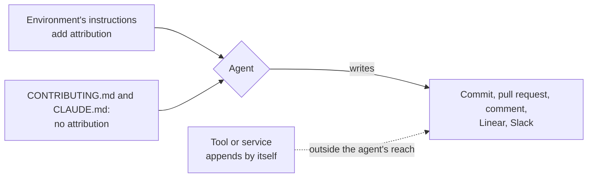

# No attribution

**Decision**: coding agents add no attribution to anything they write: no header naming who asked, no "Generated with Claude Code" footer, no session link, no `Co-Authored-By: Claude` or `Claude-Session:` trailer, in commits, pull requests, comments, Linear or Slack. The rule is in [CONTRIBUTING.md](../../CONTRIBUTING.md) ("Coding agents") and in every repository's `CLAUDE.md`. Ticket: [ENG-172](https://linear.app/arikkfir/issue/ENG-172).

## Context

- Agents ended their pull requests with `🤖 Generated with [Claude Code](…)` and a session link, opened them with `_Requested by **…** · [project thread](…)_`, and ended commits with `Co-Authored-By: Claude …` and `Claude-Session: …`. A pull request's description is its merge commit's body, so all of it landed in `git log` on `main`.
- None of these lines came from the house rules: the agents' own environment injects them as instructions. `CONTRIBUTING.md` even asked for `Co-authored-by` "also for AI pairing".

## Design

Agents read `CLAUDE.md` as their person's own instructions. Where the environment says those win, the rule stops the line; where it doesn't, the rule competes with the environment's instruction; and what a tool appends after the agent has written is out of its reach.

| Line                                                                   | Comes from                                                                     | Does the rule stop it?                                                                                                     |
|------------------------------------------------------------------------|--------------------------------------------------------------------------------|----------------------------------------------------------------------------------------------------------------------------|
| `Co-Authored-By: Claude …` and `Claude-Session: …` commit trailers     | Claude Code's attribution instructions, which yield to the user's `CLAUDE.md` | Yes                                                                                                                        |
| `🤖 Generated with Claude Code` and session link ending a pull request | The same instructions                                                          | Yes                                                                                                                        |
| `Generated by Claude Code` and session link ending a pull request      | The GitHub connector, which appends it to every pull request it opens          | No, but editing the description afterwards removes it for good: the connector doesn't add it again on an edit              |
| `Requested by … · project thread` opening a pull request               | Claude projects' session instructions, which call it required                  | Not for certain: those instructions don't yield to `CLAUDE.md`, so an agent may still add it                              |
| `Generated by Claude Code` ending a GitHub comment                     | Session instructions, and possibly the GitHub connector, as on pull requests   | Agents stop adding it; whether the connector still appends it to comments is unverified                                    |
| Lines on Linear issues and comments, Slack messages                    | Agents only, as far as the connectors' tool descriptions show                  | Yes; whether Slack's connector appends a line of its own is unverified                                                     |

## Decisions

| Decision                                                              | Why                                                                                                                         | Rejected                                                                                                          |
|-----------------------------------------------------------------------|-----------------------------------------------------------------------------------------------------------------------------|-------------------------------------------------------------------------------------------------------------------|
| No attribution anywhere an agent writes                               | The lines say nothing a reader acts on, and they fill descriptions, merge commits and comments                              | Keeping them on pull requests only: the description is the merge commit's body, so they'd still reach `main`     |
| The rule wins over the environment's instructions to add them         | Those instructions are defaults; the person who reads the result decides what it carries                                    | Following whichever instruction came last: agents would differ by session                                        |
| `Co-authored-by` stays for people                                     | It credits a person who co-wrote the change, which GitHub shows                                                             | Dropping the trailer altogether                                                                                    |
| What a tool appends by itself is edited out where it would last       | A pull request's description becomes its merge commit's body, so the connector's footer would reach `main`                  | Leaving it: the footer lands in `git log` on every merge                                                          |

## Failure modes

Nothing enforces the rule: `arikkfir-reviewer` reads the house rules and may flag a description that breaks it, but no check fails on it. A line whose source doesn't yield to `CLAUDE.md` (the `Requested by` header) can keep appearing, and a connector's footer stays on a pull request whose agent forgets to edit it out.

## Open questions

- Pull requests opened from Claude projects also start with a hidden marker, `<!-- claude-projects-attribution: … -->`. It renders nothing on GitHub but lands in the merge commit's body. The rule leaves it alone, since the project may use it to find its pull requests.

## Rollout

None: guidance only, from the next session that reads the rule.
