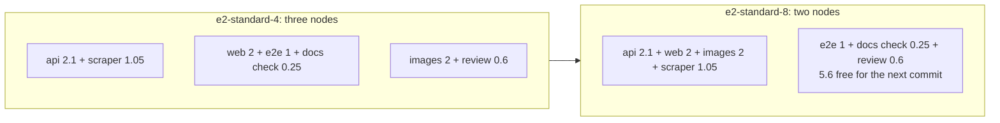

# Node autoscaling

**Decision**: The cluster autoscales with GKE's `optimize-utilization` profile instead of the default, `balanced`: each pod goes to the fullest node that fits it, and the cluster autoscaler removes empty nodes sooner. The CI pool runs up to five `e2-standard-8` nodes instead of up to ten `e2-standard-4`, the same 40 vCPUs, so a commit's 2-CPU tasks share a node. Facts: [reference](../reference.md#gke). Pull requests: arikkfir-org/infra#60 (the profile, ENG-103) and arikkfir-org/infra#61 (the machine type, ENG-104).

## Why

- On 11 October, 49 CI nodes came and went. The autoscaler removed each one 11.6 to 16.2 minutes after its last pod ended (median 11.8), and the CI pool ran 96 vCPU-hours for 20.5 CPU-hours of its pods' requests: four in five of those vCPU-hours were no pod's request.
- Fin's `api`, `web` and preview `images` tasks each request 2 CPUs, and an `e2-standard-4` node has about 3.5 free, so no two of them share a node. Each commit opened three CI nodes, and 69 of the day's 210 CI pods waited about 50 seconds for a new one.
- Two commits' runs at 16:41 took six nodes, which ran only two end-to-end tests and a review from 16:49, and stayed until 17:06:

```mermaid
gantt
  title Two commits' CI on six e2-standard-4 nodes, 11 October
  dateFormat HH:mm:ss
  axisFormat %H:%M
  section qsc2
    pods  :active, 16:40:59, 16:52:31
    empty :done, 16:52:31, 17:06:37
  section rj2l
    pods  :active, 16:41:49, 16:46:12
    empty :done, 16:46:12, 16:57:56
  section gkws
    pods  :active, 16:41:49, 16:48:47
    empty :done, 16:48:47, 17:00:21
  section h4bf
    pods  :active, 16:42:39, 16:46:28
    empty :done, 16:46:28, 16:58:01
  section p8rt
    pods  :active, 16:42:39, 16:51:48
    empty :done, 16:51:48, 17:03:36
  section 7rdn
    pods  :active, 16:42:44, 16:48:43
    empty :done, 16:48:43, 17:00:51
```

## Design

| Setting | Before | After | Where |
| --- | --- | --- | --- |
| Autoscaling profile, the cluster's | `balanced`, GKE's default | `optimize-utilization` | infra, `terraform/gcp/gke.tf` |
| CI pool's machine type | `e2-standard-4`, about 3.5 CPUs free for pods | `e2-standard-8`, about 7.5 free | infra, `terraform/gcp/variables.tf` |
| CI pool's maximum | 10 nodes, 40 vCPUs | 5 nodes, 40 vCPUs | infra, `terraform/gcp/variables.tf` |

One commit's CI requests about 9 CPUs at once. On `e2-standard-8` nodes its 2-CPU tasks share one node, and the second keeps room for the next commit's tasks:

### The replay

The day's 210 CI pods, each with its arrival, run time and request, replayed through a model of the scheduler and the cluster autoscaler: a pod that fits on no node waits 50 seconds for a new one, and an empty node goes after the time in the table. GKE doesn't publish how soon `optimize-utilization` removes an empty node, so the table brackets it. The model reproduces the day: 96.5 vCPU-hours against the real 96, and 66 pods waiting for a node against the real 69.

| Nodes | A pod goes to | Empty node kept | vCPU-hours | Pods that waited |
| --- | --- | --- | --- | --- |
| `e2-standard-4` (11 October) | the emptiest node | 12 min | 96 | 66 |
| `e2-standard-4` | the fullest node | 12 min | 87 | 76 |
| `e2-standard-4` | the fullest node | 5 min | 64 | 103 |
| `e2-standard-4` | the fullest node | 2 min | 52 | 127 |
| `e2-standard-8` | the emptiest node | 12 min | 104 | 42 |
| `e2-standard-8` | the fullest node | 12 min | 96 | 47 |
| `e2-standard-8` | the fullest node | 5 min | 76 | 71 |
| `e2-standard-8` | the fullest node | 2 min | 64 | 99 |
| `e2-standard-16` | the emptiest node | 12 min | 124 | 30 |

The model leaves out pulling images onto a new node, which bigger nodes do less often, and a task slowing when a neighbour uses more than it requests.

## Decisions

| Decision | Why | Rejected |
| --- | --- | --- |
| `optimize-utilization` | Most of the CI pool's cost is nodes kept empty, and the profile is GKE's only control over how soon they go. It also fills a node before the autoscaler opens another | `balanced`; lower requests for the 2-CPU tasks, which save 11% in the replay but slow those tasks when they share a node |
| One profile for both pools | GKE sets the profile per cluster | A profile per pool |
| `e2-standard-8` for the CI pool | A commit's 2-CPU tasks share a node, so about a third fewer pods wait for a new one, and a task that bursts past its request has spare cores beside it. With pods packed it costs what the pool costs today, and a tenth to a quarter more than `e2-standard-4` would under the same profile | `e2-standard-4`; `e2-standard-16`, where one commit fits one node but an empty node costs four times as much: 124 vCPU-hours in the replay |
| Five nodes at most | The pool's ceiling stays at 40 vCPUs, and the replay never needs more | Ten nodes, 80 vCPUs |
| The owner applies the machine type by hand | Changing it recreates every CI node, the one that runs pipeline `apply` included, and Terraform killed mid-update leaves the state lock behind | Pipeline `apply` |

## Risks

- The profile is the cluster's, so the system pool's nodes also go sooner, and the autoscaler consolidates them more often, evicting their pods each time. Services with two replicas and a budget keep serving ([disruption budgets](disruption-budgets.md)); single-replica ones, such as Argo CD's application controller, Tekton's controllers and each PostgreSQL, restart.
- A packed node holds more pods, so a pod that uses more than it requests slows its neighbours more often. Requests follow measured use ([resource requests](resource-requests.md)).
- With empty nodes gone sooner, more pods wait for a new one: about 50 seconds each, plus pulling their images.
- An `e2-standard-8` node runs about twice the pods on the same 50 GB boot disk, which their workspaces, caches and images share. Pods evicted for ephemeral storage would mean it's too small.

## Rollout

- arikkfir-org/infra#60: pipeline `apply` updates the cluster in place on merge. No node is recreated.
- arikkfir-org/infra#61: while no CI runs are in flight, the owner merges `main` into its branch, applies `gcp` from it (`make terraform gcp`), and merges it straight away, so that the merge's `apply` has nothing to change and no other merge's `apply` puts the old machine type back. A run in flight during the apply loses its pod and fails.

## Open questions

- How soon `optimize-utilization` removes an empty CI node. Measure it after the switch as for 11 October: the cluster's `RemovingNode` events against the end of each node's last run.
