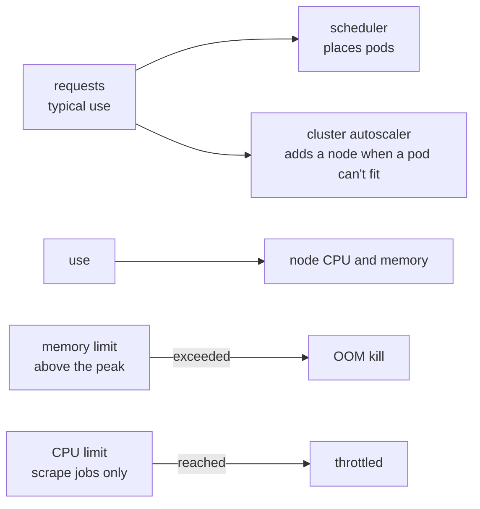

# Resource requests

**Decision**: A workload requests the CPU and memory it typically uses, as measured, and limits its memory above its peak, unless its runtime sizes itself to the limit: Java's heap is 70% of it, so Keycloak's limit is what its own sizing guide asks for. CPU stays unlimited, except for Fin's scrape jobs, capped at one CPU; existing CPU limits far above use stay. Requests are what the scheduler places pods by and what the cluster autoscaler grows the pool by, so with requests that match use, a busy node gets company instead of saturating. The sixteen workloads below, whose requests were furthest from their use, change first.

## Why

- On 11 October, two of Fin's end-to-end suites ran side by side, and the system node ran at 92–107% CPU for about ten minutes each time. Tests that take 15 seconds on a quiet node took over 30, and the merge queue dropped fin#110 twice.
- The `system` pool autoscales from one node to three ([reference](../reference.md)), but it never grew: its pods requested 3.26 of the node's 3.92 CPUs, so every new pod still fit. A pull request's scrape job requested 100m and used about half a core while it ran; six ran at once.
- The requests said the opposite of the use. Argo CD's application controller, Grafana, Traefik and Tekton's pipelines controller requested nothing, while KEDA, Keycloak, its operator and Tekton's smaller components reserved about 1.8 CPUs and used about 0.1.

## Design

Use is each container's over the week to 11 October, from Cloud Monitoring: the 95th percentile of 5-minute CPU averages over its last day, its highest 5-minute CPU average and its highest memory. Requests and limits are per replica.

| Workload | Before | After | CPU p95, peak | Memory peak | Where |
| --- | --- | --- | --- | --- | --- |
| Fin's scrape job, a pull request's | 100m, 512Mi; limit 2Gi | 500m, 512Mi; limits 1 CPU, 2Gi | about 500–700m while it runs | 386Mi | fin, `deploy/components/pull-request` |
| Fin's scrape job, production's | 500m, 1Gi; limit 2Gi | 500m, 512Mi; limits 1 CPU, 2Gi | too short to sample | 361Mi | fin, `deploy/scraper.yaml` |
| Fin's PostgreSQL, a pull request's | 20m, 128Mi; limit 1Gi | 100m, 128Mi; limit 1Gi; 150m since fin#120 | 115m, 143m | 156Mi | fin, `deploy/components/pull-request` |
| Fin's API, a pull request's | 10m, 32Mi; limit 256Mi | 20m, 48Mi; limit 256Mi; 75m since fin#120 | 44m, 67m | 41Mi | fin, `deploy/components/pull-request` |
| Fin's web | 5m, 32Mi (a pull request's 16Mi); limit 128Mi | 20m, 32Mi (a pull request's 35m since fin#120); limit 128Mi | 19m, 28m | 88Mi | fin, `deploy/web.yaml` and `deploy/components/pull-request` |
| Argo CD's application controller | nothing | 200m, 1Gi; limit 2560Mi | 185m, 933m | 1873Mi | delivery, `platform/argocd/values.yaml` |
| Grafana | nothing | 50m, 256Mi; limit 512Mi | 83m, 98m | 342Mi | delivery, `platform/grafana/values.yaml` |
| Traefik | nothing | 50m, 128Mi; limit 256Mi | 46m, 115m | 119Mi | delivery, `platform/traefik/values.yaml` |
| Tekton's pipelines controller | nothing | 100m, 256Mi; limit 512Mi | 58m, 271m | 233Mi | delivery, `platform/tekton/manifests/tekton-config.yaml` |
| Tekton's remote resolvers | 100m, 100Mi; limits 1 CPU, 4Gi | 10m, 32Mi; limits as before | 1m, 1m | 19Mi | delivery, `platform/tekton/manifests/tekton-config.yaml` |
| Tekton operator's proxy webhook | 100m, 100Mi; limits 500m, 500Mi | 10m, 48Mi; limits as before | 1m, 6m | 32Mi | delivery, `platform/tekton/manifests/tekton-config.yaml` |
| KEDA's operator | 100m, 100Mi; limits 1 CPU, 1000Mi | 20m, 96Mi; limits 1 CPU, 256Mi | 9m, 39m | 76Mi | delivery, `platform/keda/values.yaml` |
| KEDA's metrics server | 100m, 100Mi; limits 1 CPU, 1000Mi | 20m, 48Mi; limits 1 CPU, 128Mi | 6m, 6m | 40Mi | delivery, `platform/keda/values.yaml` |
| KEDA's admission webhooks | 100m, 100Mi; limits 1 CPU, 1000Mi | 20m, 32Mi; limits 1 CPU, 64Mi | 1m, 1m | 20Mi | delivery, `platform/keda/values.yaml` |
| Keycloak | 250m, 1536Mi; limit 2Gi | 25m, 1Gi; limit 1360Mi | 30m, 97m | 1180Mi | delivery, `platform/keycloak/manifests/keycloak.yaml` |
| Keycloak's operator | 300m, 450Mi; limits 700m, 450Mi | 20m, 320Mi; limits as before | 6m, 51m | 304Mi | delivery, `platform/keycloak-operator/manifests/kustomization.yaml` |

A scrape job lives 10 to 30 seconds, too short for Cloud Monitoring's per-minute samples: its use is the node's CPU above its sampled containers while scrapes ran, about 11 CPU-seconds a scrape, and its memory peak is of the scrapes that were sampled.

delivery's part is arikkfir-org/delivery#49, fin's fin#117. fin#120 then raised a pull request's API, app, worker and PostgreSQL to the 90th percentile of what they used while its suites ran, above production's, after four suites at once saturated the one system node on 11 October ([Fin environments](../../fin/designs/environments.md)).

## Decisions

| Decision | Why | Rejected |
| --- | --- | --- |
| Requests from measured typical use | The scheduler and the cluster autoscaler count requests only. A request below use packs a node past its CPU while it still looks half empty; one above use reserves room nobody uses | Requests left to charts' defaults, or none |
| No CPU limits on services | The kernel enforces a CPU limit in 100 ms slices: a process using several threads can spend its slice in a few milliseconds and stall for the rest, so a limit slows responses even on an idle node, and it frees no room, since only requests reserve any. Keycloak's sizing guide reports that its performance dropped significantly when throttled. Under contention, each container already gets CPU in proportion to its request | A CPU limit on every workload |
| One CPU limit: Fin's scrape jobs, at one CPU | A scrape is batch work, which the end-to-end tests give three minutes, and the noisiest workload: Chromium, recording video | No CPU limits at all |
| Existing CPU limits far above use stay: KEDA's, Tekton's and Keycloak's operator's | They never bind, and removing them takes overrides of charts and upstream manifests for nothing | Removing them |
| Memory limits above the measured peak, except Keycloak's | Go collects harder near a limit only when `GOMEMLIMIT` is set, PostgreSQL and Chromium don't adapt at all, and Argo CD's controller holds a cache of the cluster's resources, which grows with every pull request's Application. Java sizes its heap from the limit, so Keycloak's 1360Mi is its guide's size for 10,000 sessions: a 952Mi heap and about 300 MB outside it | Limits at typical use, relying on garbage collection |
| Tekton's pipelines webhook keeps its 100m request | Its HorizontalPodAutoscaler adds replicas at 100% of the request, up to five, so a lower request would keep five running | A lower request |

## Risks

- A week of use is short. Argo CD's controller grows with the number of open pull requests, and a peak above a memory limit kills the pod, which restarts and rebuilds its cache.
- Keycloak's heap shrinks from up to 1434Mi to 952Mi. Its guide sizes that for 10,000 sessions, far more than the hub has.
- A pull request's scrape jobs ask for five times more CPU than before. With the requests freed elsewhere, the system node fits about two at once, and fewer since fin#120 raised each open pull request's other pods by about 0.15 CPU, so a suite's third scrape, or another suite's, waits for the autoscaler to add a node and for the node to pull the scraper's image: a minute or two each, then about 45 seconds, out of the three minutes the tests give a scrape. Should that run short, the pool's minimum can rise to two nodes (infra).
- Rollout: each workload restarts once as Argo CD syncs it. Keycloak, Traefik, Grafana and KEDA roll one replica at a time; Argo CD's controller and Tekton's pipelines controller restart, and runs they reconcile wait meanwhile. Fin's environments take theirs on their next deployment.
